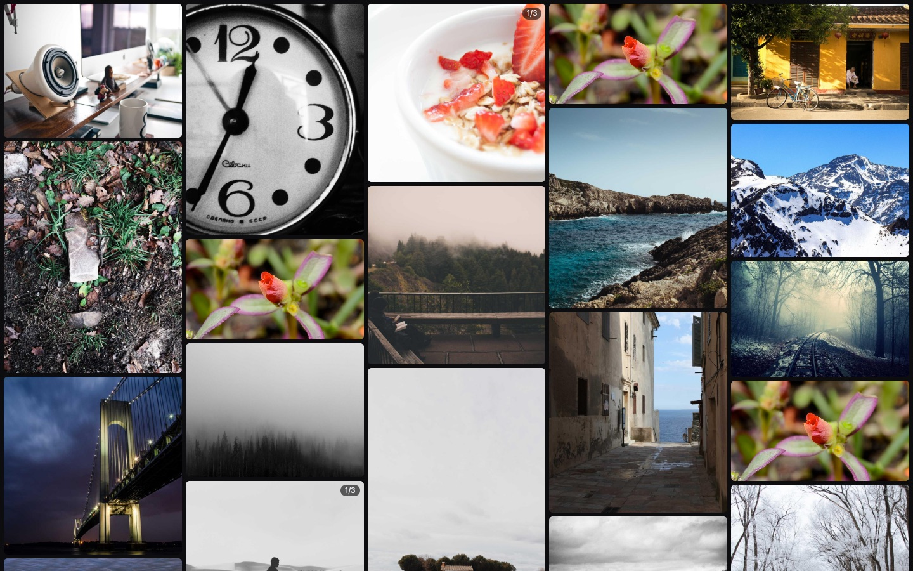
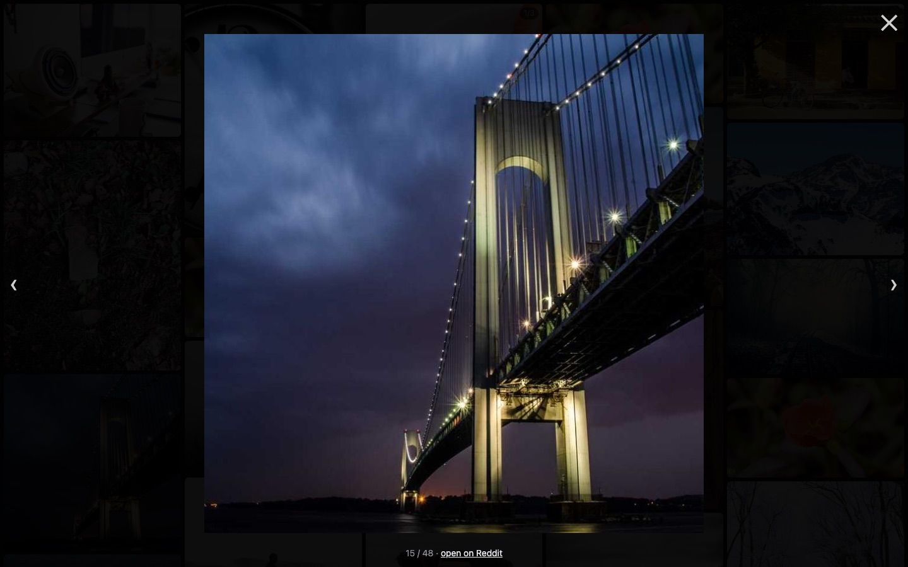

<div align="center">

# Saved Grid

**Your Reddit saved posts as one endless wall of pictures and looping videos.**

No titles, no comments, no feed. Just the media you saved, laid out in a masonry grid that runs entirely on your own machine.

[](https://github.com/mcpeixoto/SavedGrid/actions/workflows/ci.yml)
[](LICENSE)
[](https://buymeacoffee.com/mcpeixoto)



</div>

## Features

- **Masonry grid** that keeps each image's real shape, newest saves at the top
- **Videos autoplay muted and loop**, but only while on screen, so hundreds of tiles stay smooth
- **Galleries** show a `1/3` badge; open one and step through with ← →
- **Lightbox** with sound on for videos and a link back to the original post
- **Gets past Reddit's 1000-item cap** by reading your full saved list from Reddit's data export
- **Private by design**: no server, no account, no tracking. Your data never leaves your computer
- **Zero dependencies**: one HTML file, two small scripts, nothing to install or build

| Lightbox | Phone |
|---|---|
|  |  |

<sub>Screenshots use the bundled demo data (photos from [Lorem Picsum](https://picsum.photos)).</sub>

## Try the demo

```bash
git clone https://github.com/mcpeixoto/SavedGrid.git
cd SavedGrid
python3 -m http.server 8734
```

Open http://localhost:8734/?demo

## Use it online

1. Open **https://mcpeixoto.github.io/SavedGrid/** and drag the orange **Saved Grid** button to your bookmarks bar.
2. Go to [reddit.com](https://www.reddit.com) while logged in and click the bookmark.
3. Pick `saved_posts.csv` from your [Reddit data export](https://www.reddit.com/settings/data-request) (everything), or use your live saved list (newest ~1000), then click **Open grid**.

The bookmark reads your saved posts with your own Reddit login, the same way reddit.com does, and passes them straight to the grid tab. No API key, no server, nothing uploaded.

Prefer not to use a bookmark? Paste `extract.js` followed by `lookup.js` into the DevTools console on reddit.com instead; it shows the same panel.

### Sign in with Reddit (optional)

The page also supports Reddit sign-in, which needs an approved Reddit API app. Reddit now reviews new apps under its [Responsible Builder Policy](https://support.reddithelp.com/hc/en-us/articles/42728983564564-Responsible-Builder-Policy), so it's switched off until one is approved. To turn it on in your own copy: get an **installed app** approved at [reddit.com/prefs/apps](https://www.reddit.com/prefs/apps) with your page URL as the redirect URI, and put its client ID in [`config.js`](config.js).

## Run it locally

### 1. Get your saved list (pick one)

- **Full list:** request your data at [reddit.com/settings/data-request](https://www.reddit.com/settings/data-request) (choose all time). Reddit emails a zip within a few days; you need the `saved_posts.csv` inside it.
- **Right now:** skip the export. The script can read your live saved list instead, but Reddit only returns the newest ~1000 items.

### 2. Turn it into `media.json`

1. Copy the lookup script:
   ```bash
   cat extract.js lookup.js | pbcopy        # macOS
   cat extract.js lookup.js | xclip -sel c  # Linux
   ```
2. Open [reddit.com](https://www.reddit.com) while logged in, open DevTools → Console, paste, press Enter.
3. In the panel that appears, pick `saved_posts.csv` or click **Use live saved list**.
4. Click **Download media.json** and move the file into the `SavedGrid` folder.

The script runs in your own logged-in tab, asks Reddit for 100 posts per request, and pauses between requests to stay well inside rate limits.

### 3. Open the grid

```bash
python3 -m http.server 8734
```

Open http://localhost:8734. Click a tile to open it; ← → move between items, Esc closes.

## How it works

```
saved_posts.csv ──► lookup.js (in your reddit.com tab) ──► media.json ──► index.html
   post IDs            /api/info.json, 100 IDs per call       media URLs      the grid
```

- [`extract.js`](extract.js) turns one Reddit post into the media to show: images, Reddit-hosted videos, galleries, crossposts and imgur `.gifv` links. Text posts are skipped.
- [`lookup.js`](lookup.js) is the panel the bookmark opens on reddit.com: it fetches your posts and sends them to the grid (or saves `media.json`).
- [`reddit.js`](reddit.js) handles Reddit sign-in and fetching for the online version.
- [`index.html`](index.html) is the grid, lightbox and sign-in page.

## Limitations

- Media from hosts that block embedding, or need their own API key (for example some video sites), falls back to the post's thumbnail or is skipped.
- Reddit videos play without sound in the grid; open one to hear it.
- Deleted or removed posts can't be looked up and are left out.

## Contributing

Bug reports, ideas and pull requests are welcome. See [CONTRIBUTING.md](CONTRIBUTING.md) to get started. Good first contributions: support for another media host, keyboard shortcuts, or filters (images only, videos only, by subreddit).

## Support

If Saved Grid brought your saved posts back to life, you can [buy me a coffee](https://buymeacoffee.com/mcpeixoto) ☕

## License

[MIT](LICENSE)
